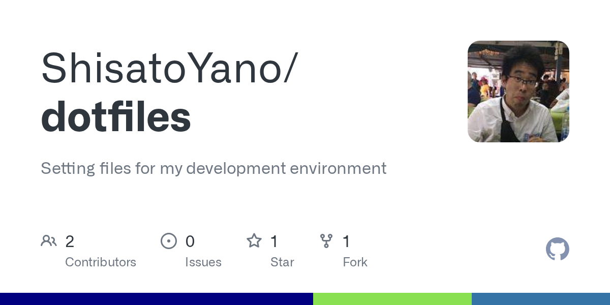

<div class="relative px-14 pt-12">

  <div class="mt-14">
    <h1 class="!text-4xl !font-black !leading-tight text-[var(--yano-accent)]">ブックマーク・タブを減らせない人にすすめたい<br>ターミナル+CLIによる整理整頓術</h1>
    <div class="mt-5 text-lg font-bold text-gray-400">Terminal Night 3 2026.10.15</div>
  </div>

  <div class="absolute left-14 top-[420px] flex items-center gap-5">
    
    <div>
      <div class="text-xl font-bold">Shisato Yano</div>
      <div class="text-sm text-gray-400">自動運転システムエンジニア</div>
    </div>
  </div>
</div>

---

## 自己紹介

<div class="mt-8 flex items-center gap-12">
  
  <div>
    <div class="text-4xl font-black">Shisato Yano</div>
    <div class="mt-4 text-base leading-relaxed text-gray-600 dark:text-gray-300">
      仕事: 車や船の自動運転システムを作るソフトウェアエンジニア<br>
      環境: Ubuntu / WezTerm / bash / Neovim<br>
      一言: 今日が初イベント参加、初登壇です！よろしくおねがいします！！
    </div>
    <div class="mt-4 flex gap-6 text-base">
      <a href="https://x.com/4310sy" target="_blank" class="flex items-center gap-2 !text-gray-700 dark:!text-gray-300 !border-none">
        <carbon-logo-x class="text-xl" />@4310sy
      </a>
      <a href="https://github.com/ShisatoYano" target="_blank" class="flex items-center gap-2 !text-gray-700 dark:!text-gray-300 !border-none">
        <carbon-logo-github class="text-xl" />ShisatoYano
      </a>
    </div>
  </div>
</div>

<Callout label="今日のゴール" class="mt-8">
  増え続けるブックマークとタブを、ターミナルからコマンドで探して・片付けられるようになる
</Callout>

---

## ブックマークが増えるとつらみも増える

<div class="mt-10 grid grid-cols-[2fr_3fr] gap-6 items-start">

<div class="text-lg whitespace-nowrap">

<v-clicks>

- ぐちゃったブックマークが視界に入って落ち着かない
- 見たいものを探し出すのが面倒になる
- タブで開きっぱにしてさらにカオスになる
- ブラウザでちまちま削除・整理するのもまた面倒

</v-clicks>

</div>

<div class="grid">
  
  
  
  
</div>

</div>

<KeyMessage v-click>

  ターミナル+CLIを駆使してそんなつらみから開放されよう！！

</KeyMessage>

---

## 全体像: 小さなCLIをパイプでつなぐだけ

<div class="mt-16 flex items-center justify-center text-center">
  <div class="node">ブラウザの<br>タブ</div>
  <div v-click class="flex items-center">
    <div class="edge"><code>tabctl</code><span>一覧にする</span></div>
    <div class="node">タブの<br>一覧</div>
  </div>
  <div v-click class="flex items-center">
    <div class="edge"><code>fzf</code><span>選ぶ</span></div>
    <div class="node">選んだ<br>タブ</div>
  </div>
  <div v-click class="flex items-center">
    <div class="edge"><code>buku</code><span>保存する</span></div>
    <div class="node is-goal">タグ付きの<br>ブックマーク</div>
  </div>
</div>

<div v-click class="mt-8 text-center text-lg">
  保存したタブは <code>tabctl</code> で閉じる。探すときは <code>buku</code> + <code>fzf</code> で検索
</div>

<KeyMessage v-click>

  1つのことをうまくやるCLIを、パイプでつなぐだけ！！

</KeyMessage>

<style>
.node {
  width: 8.5rem;
  padding: 0.9rem 0.5rem;
  border: 2px solid #d1d5db;
  border-radius: 0.6rem;
  font-weight: 700;
  line-height: 1.4;
}

.node.is-goal {
  border-color: var(--yano-accent);
  color: var(--yano-accent);
}

/* 矢印の上にツール名、下に役割を置く */
.edge {
  position: relative;
  display: flex;
  flex-direction: column;
  align-items: center;
  width: 6.5rem;
  font-size: 0.8rem;
}

.edge::after {
  content: '→';
  order: 1;
  font-size: 1.5rem;
  line-height: 1;
  color: var(--yano-muted);
}

.edge code {
  order: 0;
  font-weight: 700;
  color: var(--yano-accent);
}

.edge span {
  order: 2;
  color: var(--yano-muted);
}
</style>

---
clicks: 3
---

## ブラウザ管理からターミナル管理へ移行

<div class="mt-10 grid grid-cols-[2fr_3fr] gap-6 items-start">

<div class="text-lg whitespace-nowrap">

- **buku**: ブックマーク管理のCLI
- 追加・削除・タグ付けがターミナルで完結
- ブラウザから一括インポートできる

</div>

<BukuImportFlow :stage="$clicks" />

</div>

<KeyMessage v-click="3">

  これで面倒なブラウザ操作とはおさらば！！

</KeyMessage>

<Ref>

<carbon-logo-github /> [jarun/buku](https://github.com/jarun/buku)

</Ref>

---

## 大量ブックマークからでもさくっと検索

<div class="mt-8 grid grid-cols-[2fr_3fr] gap-8 items-start">

<div class="text-lg whitespace-nowrap">

- **タグ**で分類、フォルダ分けは不要
- **fzf**であいまい検索して開く
- 複数まとめて開ける

</div>

```bash {1-2|4-6|8-9|11-12|all}
# タグを付けて追加
buku -a https://example.com cli,linux

# 既存のブックマーク(15番)にタグを追加/削除
buku -u 15 --tag + terminal
buku -u 15 --tag - linux

# タグで絞り込む
buku -t cli

# fzfであいまい検索して開く(自作スクリプト)
bb
```

</div>

<KeyMessage v-click>

  これで検索に手こずる心配なし！心置きなくブックマークを増やしましょう！！

</KeyMessage>

<Ref>

<carbon-logo-github /> [junegunn/fzf](https://github.com/junegunn/fzf)

</Ref>

---
clicks: 4
---

## ターミナルからタブを操ろう

<TabArchiveFlow :stage="$clicks" />

<Ref>

<carbon-logo-github /> [slastra/tabctl](https://github.com/slastra/tabctl)(<ph-google-chrome-logo /> [Chrome拡張機能](https://chromewebstore.google.com/detail/tabctl/baomblllgemcgbignhpbipgiofmjdhpn)も必要)

</Ref>

---

## 保存から閉じるまでを関数1つに

<!-- 注釈付きのコードがこのスライドの主役なので、標準(12px)より大きくする -->
<AnnotatedCode class="mt-4" style="--slidev-code-font-size: 16px">

```bash
tabarchive() {
  tabctl list | fzf --multi |
  while IFS=$'\t' read -r id title url; do
    buku --nostdin -a "$url" tab-archive --title "$title"
    tabctl close "$id"
  done
}
```

<CodeRegion v-click :line="2" text="fzf --multi" label="Tab で複数選択" />
<CodeRegion v-click :line="4" text="tab-archive" label="付けるタグ" color="#ef4444" />
<CodeRegion v-click :line="4" text='--title "$title"' label="タブのタイトルをそのまま使う" color="#16a34a" label-position="below" />
<CodeRegion v-click :line="5" text='tabctl close "$id"' label="保存したら閉じる" color="#9333ea" label-position="below" />

</AnnotatedCode>

<KeyMessage v-click>

  基本はここまで！おまけで応用編も紹介します！！

</KeyMessage>

---

## 応用: 保存時に要約メモを作る

<div class="mt-6 grid grid-cols-[2fr_3fr] gap-8 items-start">

<div class="text-lg whitespace-nowrap">

- **Claude Code**で本文を要約
- **nb**にMarkdownのメモで保存
- tabarchive に数行足すだけ

</div>

````md magic-move
```bash
tabarchive() {
  tabctl list | fzf --multi |
  while IFS=$'\t' read -r id title url; do
    buku --nostdin -a "$url" tab-archive \
      --title "$title"
    tabctl close "$id"
  done
}
```

```bash
tabnote() {
  tabctl list | fzf --multi |
  while IFS=$'\t' read -r id title url; do
    buku --nostdin -a "$url" tab-archive \
      --title "$title"
    # ページ本文をClaudeで要約
    summary=$(curl -sL "$url" |
      sed 's/<[^>]*>//g' | claude -p "要約して")
    # 要約に失敗したらタブを閉じずに残す
    [ -n "$summary" ] || continue
    # 要約をnbにメモとして保存
    nb tab-archive:add --title "$title" \
      --content "$summary" < /dev/null
    tabctl close "$id"
  done
}
```
````

</div>

<KeyMessage v-click>

  さっと読みたいとき、ネットないけど読みたいときに便利！！

</KeyMessage>

<Ref>

<carbon-logo-github /> [xwmx/nb](https://github.com/xwmx/nb) / [mozumasu/nb.nvim](https://github.com/mozumasu/nb.nvim)

</Ref>

---

## まとめ

<v-clicks>

<div class="summary">
  <div class="summary-verb">探す</div>
  <div><code>buku</code> のタグ + <code>fzf</code> のあいまい検索で、大量のブックマークからすぐ見つかる</div>
</div>

<div class="summary">
  <div class="summary-verb">片付ける</div>
  <div><code>tabctl</code> でタブを選んで <code>buku</code> に保存し、そのまま閉じる</div>
</div>

<div class="summary">
  <div class="summary-verb">読み返す</div>
  <div>保存のついでに Claude で要約して、<code>nb</code> にメモを残す</div>
</div>

</v-clicks>

<KeyMessage v-click>

  ブックマーク・タブを減らせなくても、ターミナルからなら気軽に片付けられる！！

</KeyMessage>

<style>
.summary {
  display: grid;
  grid-template-columns: 7rem 1fr;
  gap: 1rem;
  align-items: center;
  margin-top: 1.5rem;
  font-size: 1.15rem;
}

.summary-verb {
  padding: 0.4rem 0;
  border-radius: 0.5rem;
  background: var(--yano-accent-soft);
  text-align: center;
  font-weight: 900;
  color: var(--yano-accent);
}
</style>

---

## 設定はこちら

<div class="mt-10 grid grid-cols-[2fr_3fr] gap-10 items-center">

<div>

<div class="text-lg leading-loose">

- スクリプト1発で自動環境構築
- Linux(Ubuntu)でのみ動作確認済み
- Issue/PR大歓迎！

</div>

<div class="mt-4 text-sm font-bold text-gray-500 dark:text-gray-400">まず試すなら</div>

```bash
sudo apt install buku fzf
buku -a https://example.com cli
buku -t cli
```

</div>

<a href="https://github.com/ShisatoYano/dotfiles" target="_blank" class="!border-none">
  
</a>

</div>

---
layout: center
---

<div class="text-center">
  <div class="text-5xl font-black text-[var(--yano-accent)]">ご清聴ありがとうございました </div>
  <div class="mt-6 text-xl font-bold text-red-400"> あなたのブックマーク・タブ管理が少しでも快適になりますように🙏 </div>
</div>
