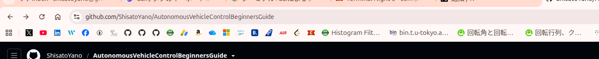
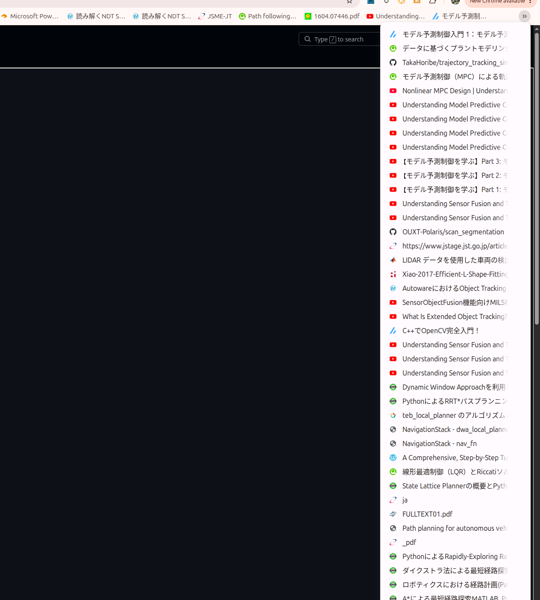
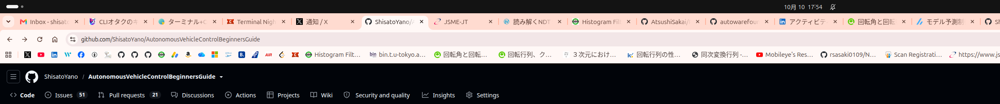
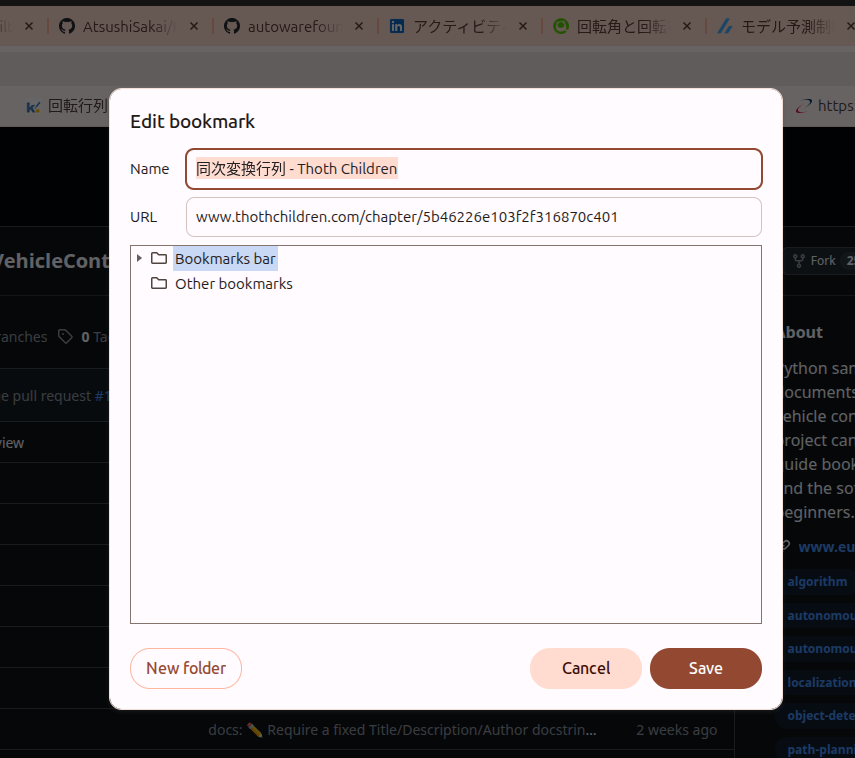
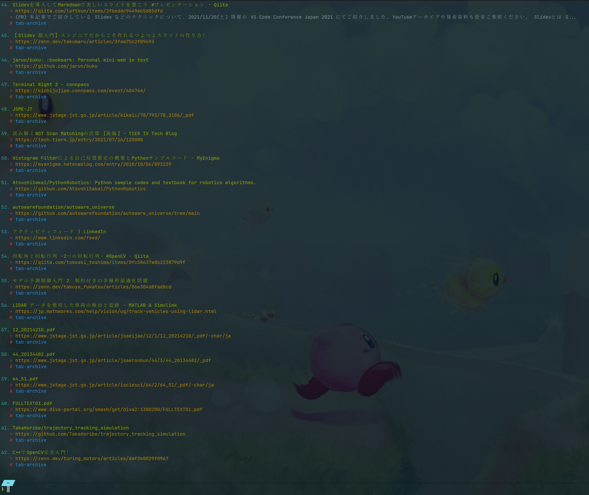

<div class="relative px-14 pt-12">

  <div class="mt-14">
    <h1 class="!text-4xl !font-black !leading-tight text-sky-700">ブックマーク・タブを減らせない人にすすめたい<br>ターミナル+CLIによる整理整頓術</h1>
    <div class="mt-5 text-lg font-bold text-gray-400">Terminal Night 3 2026.10.15</div>
  </div>

  <div class="absolute left-14 top-[420px] flex items-center gap-5">
    
    <div>
      <div class="text-xl font-bold">Shisato Yano</div>
      <div class="text-sm text-gray-400">自動運転システムエンジニア</div>
    </div>
  </div>
</div>

---

<div class="text-3xl font-black">自己紹介</div>

<div class="absolute inset-0 flex items-center justify-center gap-16">
  
  <div>
    <div class="text-4xl font-black">Shisato Yano</div>
    <div class="mt-5 text-base leading-relaxed text-gray-600">
      仕事: 車や船の自動運転システムを作るソフトウェアエンジニア<br>
      趣味: 卓球、ボルダリング、旅行、OSS開発<br>
      一言: 今日が初イベント参加、初登壇です！よろしくおねがいします！！
    </div>
    <div class="mt-6 flex gap-6 text-base">
      <a href="https://x.com/4310sy" target="_blank" class="flex items-center gap-2 !text-gray-700 !border-none">
        <carbon-logo-x class="text-xl" />@4310sy
      </a>
      <a href="https://github.com/ShisatoYano" target="_blank" class="flex items-center gap-2 !text-gray-700 !border-none">
        <carbon-logo-github class="text-xl" />ShisatoYano
      </a>
    </div>
  </div>
</div>

---

<div class="text-3xl font-black">ブックマークが増えるとつらみも増える</div>

<div class="mt-10 grid grid-cols-[2fr_3fr] gap-6 items-start">

<div class="text-lg whitespace-nowrap">

<v-clicks>

- ぐちゃったブックマークが視界に入って落ち着かない
- 見たいものを探し出すのが面倒になる
- タブで開きっぱにしてさらにカオスになる
- ブラウザでちまちま削除・整理するのもまた面倒

</v-clicks>

</div>

<div class="grid">
  
  
  
  
</div>
  
</div>

<div v-click class="absolute bottom-12 inset-x-0 text-xl font-black text-red-500 text-center">

  ターミナル+CLIを駆使してそんなつらみから開放されよう！！

</div>

---

<div class="text-3xl font-black">ブラウザ管理からターミナル管理へ移行</div>

<div class="mt-10 grid grid-cols-[2fr_3fr] gap-6 items-start">

<div v-click class="text-lg whitespace-nowrap">

- buku
  - ローカルのDBでブックマークを管理できるCLIツール
  - ターミナルからの追加、削除、編集が可能になる
  - mdやhtml形式でのインポート/エクスポートも可能
  - <carbon-logo-github /> [jarun/buku](https://github.com/jarun/buku)

</div>

<div class="grid">
  
</div>

</div>

<div v-click class="absolute bottom-12 inset-x-0 text-xl font-black text-red-500 text-center">

  これで面倒なブラウザ操作とはおさらば！！

</div>

---

<div class="text-3xl font-black">大量ブックマークからでもさくっと検索</div>

<div class="mt-10 grid grid-cols-[auto_1fr] gap-8 items-start">

<div v-click class="text-lg whitespace-nowrap">

- bukuのタグ付け機能
  - ジャンルなどによってタグ付け
  - フォルダ作って整理するような面倒さがなくなる
  - タグ付け、削除の操作はターミナルからコマンド一発
- fzfとの連携
  - タイトルやタグであいまい検索して選択
  - ヒットした複数ブックマークも同時に開けちゃう
  - <carbon-logo-github /> [junegunn/fzf](https://github.com/junegunn/fzf)

</div>

<div v-click class="grid">

```bash
# タグを付けて追加
buku -a https://example.com cli,linux

# 既存のブックマーク(15番)にタグを追加/削除
buku -u 15 --tag + terminal
buku -u 15 --tag - linux

# タグで絞り込む
buku -t cli

# fzfであいまい検索して開く(自作スクリプト)
bb
```

</div>

</div>

<div v-click class="absolute bottom-12 inset-x-0 text-xl font-black text-red-500 text-center">

  これで検索に手こずる心配なし！心置きなくブックマークを増やしましょう！！

</div>

---

<div class="text-3xl font-black">ターミナルからタブを操ろう</div>

<div class="mt-10 grid grid-cols-[auto_1fr] gap-8 items-start">

<div v-click class="text-lg whitespace-nowrap">

- tabctl
  - ブラウザのタブをターミナルから操作するためのCLIツール
  - タブの一覧取得、切り替え、オープン/クローズ
  - <carbon-logo-github /> [slastra/tabctl](https://github.com/slastra/tabctl)
  - <ph-google-chrome-logo /> [Chrome拡張機能](https://chromewebstore.google.com/detail/tabctl/baomblllgemcgbignhpbipgiofmjdhpn)も別途インストールが必要
- buku, fzfとの連携
  - ターミナルから指定したタブのページをブックマーク保存
  - 保存から閉じるまでを自動化できる
  - 複数タブも同時に保存できる

</div>

<div v-click class="grid">

```bash
tabarchive() {
  # 閉じたいタブをfzfで選ぶ(Tabで複数選択)
  tabctl list | fzf --multi |
  while IFS=$'\t' read -r id title url; do
    # タグを付けてbukuに保存
    buku --nostdin -a "$url" tab-archive \
      --title "$title"
    # 保存したタブを閉じる
    tabctl close "$id"
  done
}
```

</div>

</div>

<div v-click class="absolute bottom-12 inset-x-0 text-xl font-black text-red-500 text-center">

  基本はここまで！おまけで応用編も紹介します！！

</div>

---

<div class="text-3xl font-black">保存時に要約メモを作る</div>

<div class="mt-10 grid grid-cols-[2fr_3fr] gap-6 items-center">

<div v-click class="text-base whitespace-nowrap">

- Claude Codeとの連携
  - ブックマーク保存時にページ本文を取得
  - 「要約して」のプロンプトと一緒にClaudeに投げる
- nbとの連携
  - マークダウンでメモ作成、管理ができるCLIツール
  - Claudeが生成した要約をnbでメモとして保存
  - <carbon-logo-github /> [xwmx/nb](https://github.com/xwmx/nb)
  - <carbon-logo-github /> [mozumasu/nb.nvim](https://github.com/mozumasu/nb.nvim)

</div>

<div v-click class="grid">

```bash
tabnote() {
  tabctl list | fzf --multi |
  while IFS=$'\t' read -r id title url; do
    buku --nostdin -a "$url" tab-archive \
      --title "$title"
    # ページ本文をClaudeで要約
    summary=$(curl -sL "$url" |
      sed 's/<[^>]*>//g' | claude -p "要約して")
    # 要約に失敗したらタブを閉じずに残す
    [ -n "$summary" ] || continue
    # 要約をnbにメモとして保存
    nb tab-archive:add --title "$title" \
      --content "$summary" < /dev/null
    tabctl close "$id"
  done
}
```

</div>

</div>

<div v-click class="mt-10 text-xl font-black text-red-500 text-center">

  さっと読みたいとき、ネットないけど読みたいときに便利！！

</div>

---

<div class="text-3xl font-black">設定はこちら</div>

<div class="mt-10 grid grid-cols-[2fr_3fr] gap-6 items-center">

<div class="text-base whitespace-nowrap">

- 同じ環境設定がスクリプト1発で自動構築できます
- Linux(Ubuntu)でのみ動作確認済み
- 不具合とか改善アイディアあったらいつでもIssue/PRください！

</div>

<div class="grid">

<a href="https://github.com/ShisatoYano/dotfiles" target="_blank" class="!border-none">
  
</a>

</div>

</div>

---
layout: center
---

<div class="text-center">
  <div class="text-5xl font-black text-sky-700">ご清聴ありがとうございました </div>
  <div class="mt-6 text-xl font-bold text-red-400"> あなたのブックマーク・タブ管理が少しでも快適になりますように🙏 </div>
</div>

