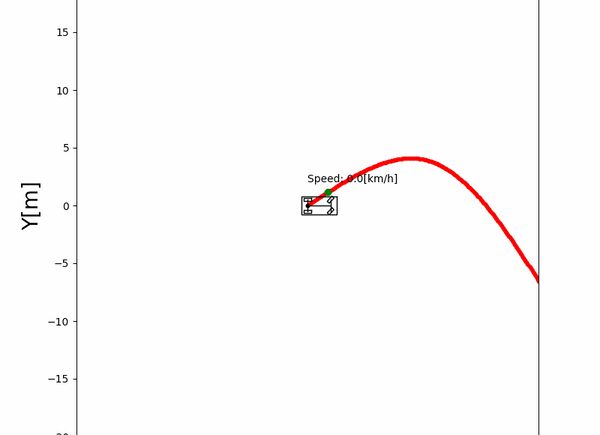
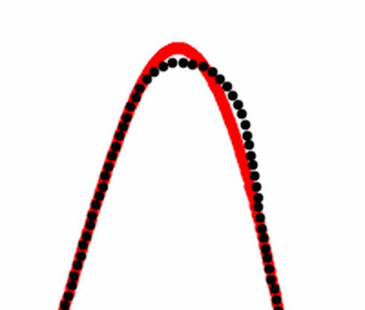
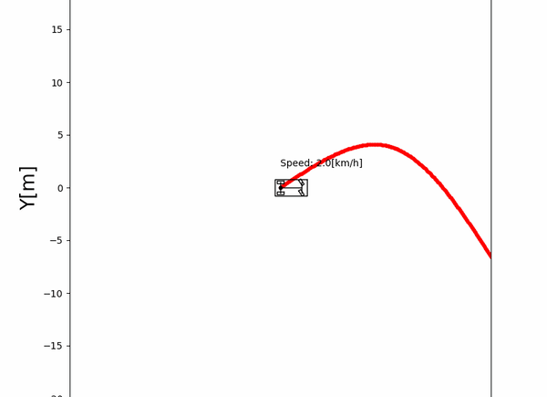
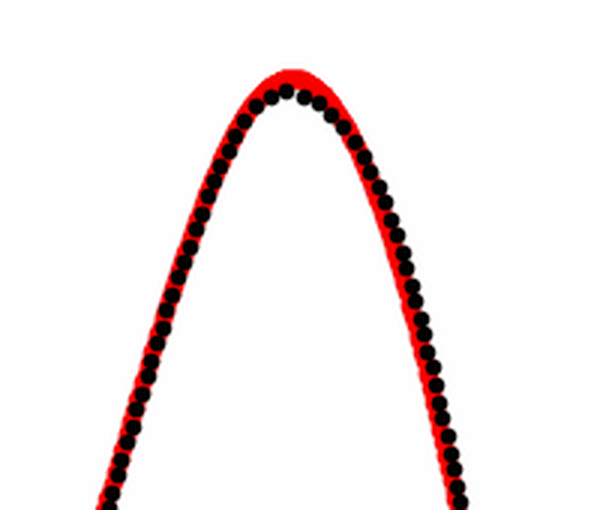

<div class="relative px-14 pt-12">

  <div class="mt-14">
    <h1 class="!text-4xl !font-black !leading-tight text-[var(--yano-accent)]">無ければ作ろう！<br>理想の技術書籍を作るOSSプロジェクト</h1>
    <div class="mt-4 text-xl font-bold text-gray-500">Want it or make it! An OSS project for the best tech readings</div>
    <div class="mt-4 text-lg font-bold text-gray-400">//localboast Tokyo 2026.11.05</div>
  </div>

  <div class="absolute left-14 top-[420px] flex items-center gap-5">
    
    <div>
      <div class="text-xl font-bold">Shisato Yano</div>
      <div class="text-sm text-gray-400">自動運転システムエンジニア / Autonomous driving software engineer</div>
    </div>
  </div>
</div>

---

## 自己紹介 <span class="en">About me</span>

<div class="mt-4 grid grid-cols-2 gap-10 items-start">

<div>
  <div class="flex items-center gap-5">
    
    <div>
      <div class="text-3xl font-black">Shisato Yano</div>
      <div class="mt-2 flex gap-5 text-sm">
        <a href="https://x.com/4310sy" target="_blank" class="flex items-center gap-1 !text-gray-700 dark:!text-gray-300 !border-none">
          <carbon-logo-x />@4310sy
        </a>
        <a href="https://github.com/ShisatoYano" target="_blank" class="flex items-center gap-1 !text-gray-700 dark:!text-gray-300 !border-none">
          <carbon-logo-github />ShisatoYano
        </a>
      </div>
    </div>
  </div>
  <div class="mt-5 text-base leading-snug text-gray-600 dark:text-gray-300">
    自動運転システムを作るソフトウェアエンジニア<br>
    <span class="text-sm text-gray-400">Software engineer building autonomous driving systems</span>
  </div>
</div>

<div>
  <div class="text-base font-bold text-gray-600 dark:text-gray-300">自動運転システムとは？ <span class="text-sm text-gray-400">What's an autonomous system?</span></div>
  <div class="mt-2 grid">
    
    
  </div>
  <div class="grid mt-1 text-sm">
    <div v-click="[1, 2]" class="[grid-area:1/1]">でっかいトラックを無人で動かしたり<div class="text-xs text-gray-400">Driving giant trucks with nobody aboard</div></div>
    <div v-click="2" class="[grid-area:1/1]">海の上で船を自律航行させたり<div class="text-xs text-gray-400">Letting boats sail on their own</div></div>
  </div>
</div>

</div>

<Callout v-click="3" label="今日紹介するもの / What I'll introduce" class="mt-4">
  <div class="text-2xl font-black text-[var(--yano-accent)]">自動運転ソフトウェア開発の入門書を作るOSSプロジェクト</div>
  <div class="text-sm text-gray-500 dark:text-gray-400">An OSS project for a beginner's guide to autonomous driving software</div>
</Callout>

<Ref v-click="[1, 2]">

[コマツ ニュースリリース(2026年4月22日)](https://www.komatsu.jp/ja/newsroom/2026/20260422)

</Ref>

<Ref v-click="2">

[エイトノット 公式サイト](https://8kt.jp/)

</Ref>

<!--
25秒。(クリック)鉱山の無人ダンプ → (クリック)小型船の自律航行と、陸でも海でも自動運転を作ってきた → (クリック)今日は、自動運転の入門書をOSSで作っている話をします
-->

---

## 自動運転を学ぶ上でのつらみ <span class="en">The pain of learning autonomous driving</span>

<div class="text-base text-gray-600 dark:text-gray-300">
  <span class="text-3xl font-black text-[var(--yano-emphasis)]">技術の総合格闘技</span> と言われるくらい、必要な知識の幅が広い
  <div class="text-sm text-gray-400">It takes a wide range of tech, like mixed martial arts</div>
</div>

<div class="autonomy">

<AutonomyScene class="mt-1" :play="$clicks >= 1" />

<div class="map mt-4">
  <div v-click="1" class="layer flow">
    <div class="row-label" style="grid-row: 1">要素技術</div>
    <div class="node" style="--i: 0; grid-column: 2 / 8">センシング</div>
    <div class="node" style="--i: 1; grid-column: 8 / 14">自己位置推定</div>
    <div class="node" style="--i: 2; grid-column: 14 / 20">認識</div>
    <div class="node" style="--i: 3; grid-column: 20 / 26">経路計画</div>
    <div class="node" style="--i: 4; --len: 2; grid-column: 26 / 32">制御</div>
  </div>
  <div v-click="2" class="layer base">
    <div class="row-label" style="grid-row: 2">基礎知識</div>
    <div class="node" style="--i: 0; grid-column: 2 / 7">数学</div>
    <div class="node" style="--i: 1; grid-column: 7 / 12">物理学</div>
    <div class="node" style="--i: 2; grid-column: 12 / 17">アルゴリズム</div>
    <div class="node" style="--i: 3; grid-column: 17 / 22">データ構造</div>
    <div class="node" style="--i: 4; grid-column: 22 / 27">ソフト設計</div>
    <div class="node" style="--i: 5; grid-column: 27 / 32">システム<br>アーキテクチャ</div>
  </div>
  <div v-click="3" class="layer">
    <div class="band" style="grid-area: 1 / 2 / 2 / 20"><span class="band-tag">よくある本のカバー範囲</span></div>
    <div class="band" style="grid-area: 2 / 2 / 3 / 22"></div>
    <div class="hole" style="grid-area: 1 / 20 / 2 / 32"></div>
    <div class="hole" style="grid-area: 2 / 22 / 3 / 32"></div>
  </div>
  <div v-click="4" class="gap-note">
    <span class="gap-label">全部を通しで学べる本は見つからなかった <span class="text-xs opacity-80">/ None covered it all</span></span>
  </div>
</div>

</div>

<div v-click="5" class="finale">
  <div class="finale-text">無ければ作ろう！</div>
  <div class="finale-en">Want it or make it!</div>
</div>

<style>
/* 場面の各段階と、流れの箱の点灯を同じ時刻で進める */
.autonomy {
  --scene-start: 0.9s;
  --scene-step: 1.2s;
}

/* 流れ・土台・本の帯を、行ラベルの列 + 30列(要素技術5つ・基礎知識6つが割り切れる)の同じ格子の層として重ね、帯がどの箱にかぶるかを位置で示す */
.map {
  position: relative;
  display: grid;
}

/* 層ごとに v-click の表示切り替えが効くよう、display: contents にはしない */
.layer {
  grid-area: 1 / 1;
  display: grid;
  grid-template-columns: 4rem repeat(30, 1fr);
  grid-template-rows: 3rem 3rem;
  gap: 0.75rem 0.5rem;
}

.row-label {
  grid-column: 1;
  display: grid;
  place-items: center start;
  font-size: 0.85rem;
  font-weight: 900;
  line-height: 1.2;
  color: var(--yano-accent);
}

.node {
  display: grid;
  place-items: center;
  text-align: center;
  line-height: 1.2;
  border: 2px solid var(--yano-accent);
  border-radius: 0.5rem;
  background: var(--yano-accent-soft);
  font-size: 1.1rem;
  font-weight: 700;
}

.flow .node {
  grid-row: 1;
}

.base .node {
  grid-row: 2;
  border-style: dashed;
  font-size: 0.95rem;
}

/* v-click で見えた瞬間から、--i の順に少しずつずらして出す */
.flow:not(.slidev-vclick-hidden) .node {
  animation:
    pop 0.35s both calc(var(--i) * 0.12s),
    lit calc(var(--scene-step) * var(--len, 1)) calc(var(--scene-start) + var(--i) * var(--scene-step));
}

.base:not(.slidev-vclick-hidden) .node {
  animation: rise 0.4s both;
  animation-delay: calc(var(--i) * 0.12s);
}

.band {
  position: relative;
  z-index: 1;
  border: 2px solid var(--yano-muted);
  border-radius: 0.5rem;
  background: color-mix(in srgb, var(--yano-muted) 30%, transparent);
}

.band-tag {
  position: absolute;
  top: -0.7rem;
  left: 0.4rem;
  padding: 0 0.4rem;
  border-radius: 0.25rem;
  background: var(--yano-muted);
  color: white;
  font-size: 0.75rem;
  font-weight: 700;
  white-space: nowrap;
}

/* 本がカバーしていない箱を、赤い点線で囲んで抜けを目立たせる */
.hole {
  margin: -0.25rem;
  border: 3px dashed var(--yano-emphasis);
  border-radius: 0.6rem;
}

.gap-note {
  position: absolute;
  inset: auto 0 -2.5rem;
}

.gap-label {
  position: absolute;
  left: 50%;
  bottom: 0;
  transform: translateX(-50%);
  white-space: nowrap;
  font-size: 1.1rem;
  font-weight: 900;
  color: var(--yano-emphasis);
}

/* 締めの一言は KeyMessage(下部)ではなく、図の上に重ねて中央に大きく出す */
.finale {
  position: absolute;
  inset: 0;
  z-index: 10;
  display: grid;
  place-content: center;
  text-align: center;
  background: color-mix(in srgb, var(--yano-accent-soft) 85%, transparent);
}

.finale:not(.slidev-vclick-hidden) .finale-text {
  animation: pop 0.4s both;
}

.finale-text {
  font-size: 4.5rem;
  font-weight: 900;
  line-height: 1.2;
  color: var(--yano-emphasis);
}

.finale-en {
  font-size: 1.5rem;
  font-weight: 700;
  color: var(--yano-muted);
}

@keyframes lit {
  15%, 85% { background: var(--yano-accent); color: white; }
}

@keyframes pop {
  from { opacity: 0; transform: scale(0.6); }
  to { opacity: 1; transform: scale(1); }
}

@keyframes rise {
  from { opacity: 0; transform: translateY(1rem); }
  to { opacity: 1; transform: translateY(0); }
}
</style>

<!--
60秒。自動運転は「技術の総合格闘技」と言われるくらい、知識の幅が広い。自分も新卒で配属されたとき、講習で学べたのは理論までで、残りは本・記事・サンプルコードの寄せ集めだった
→ (クリック)アニメーションが自動で流れる。センサで周りを見て、自分の位置を推定して、障害物を認識して、よける道を決めて、その道に沿うようにハンドルを切る。それぞれが1つの分野
→ (クリック)しかもその下に、数学、物理学、アルゴリズムとデータ構造、ソフト設計、それを1つにまとめるシステムアーキテクチャといった基礎知識がある
→ (クリック)本はたくさんある。でもよくあるのは、大体はカバーしているけれど、経路計画や制御までは無い、設計やアーキテクチャまでは触れていない、という本
→ (クリック)自分が探した範囲では、全部を通しで学べる本は見つからなかった
→ (クリック)だったら、無ければ作ろう！
-->

---

## ハンドルの切り方は、1行差し替えるだけで変えられる <span class="en">Swap one line to change how it steers</span>

<div class="mt-4 grid grid-cols-2 gap-6">

<Callout label="Pure Pursuit">
  少し先の道の一点を目指してハンドルを切る
  <div class="text-sm text-gray-500 dark:text-gray-400">Aim at a point a little ahead (like a human driver)</div>
</Callout>

<Callout label="Stanley">
  前輪がコースからずれた分を直す
  <div class="text-sm text-gray-500 dark:text-gray-400">Correct how far the front wheel is off the course</div>
</Callout>

</div>

<div class="mt-4">

````md magic-move
```python
# ハンドルの切り方(制御方式)を作る
controller = PurePursuitController(spec, course)
# 車に持たせて走らせる
vehicle = FourWheelsVehicle(state, spec, controller=controller)
vis.add_object(vehicle)
vis.draw()
```

```python
# ハンドルの切り方(制御方式)を作る
controller = StanleyController(spec, course)
# 車に持たせて走らせる
vehicle = FourWheelsVehicle(state, spec, controller=controller)
vis.add_object(vehicle)
vis.draw()
```
````

</div>

<KeyMessage v-click>

  制御の部品を1行取り替えるだけで、違う走り方を試せる <span class="en">Swap one line and try a different way to drive</span>

</KeyMessage>

<Ref>

シミュレーションのコードから抜粋(変数名は簡略化)

</Ref>

<!--
60秒。Pure Pursuitは人が運転するときと同じで、少し先を見る。Stanleyは足元(前輪)のずれを見る。
「なぜこの作りか」: 車・コース・制御方式を別々の部品にしてあるので、制御方式を取り替えても他は一切変えなくていい。
だから同じ条件で比べられる
-->

---

## 走らせて比べる <span class="en">Run and compare</span>

<div class="mt-2 text-center text-base">
  <span class="font-bold text-red-500">赤い線</span> = 走ってほしいコース、<span class="font-bold">黒い点</span> = 実際に走った跡
  <span class="text-sm text-gray-400">/ Red: the course, Black: where the car actually went</span>
</div>

<div class="mt-3 grid grid-cols-2 gap-8 text-center">

<div>
  <div class="text-lg font-black text-[var(--yano-accent)]">Pure Pursuit</div>
  <div class="grid">
    
    
  </div>
  <div v-click="1" class="mt-1 text-sm">急カーブで内側を近道し、抜けたあと外に膨らむ</div>
</div>

<div>
  <div class="text-lg font-black text-[var(--yano-accent)]">Stanley</div>
  <div class="grid">
    
    
  </div>
  <div v-click="1" class="mt-1 text-sm">急カーブでもコースにぴったり沿う</div>
</div>

</div>

<KeyMessage v-click="2">

  同じ車・同じコースでも、ハンドルの切り方で走りが変わる <span class="en">Same car, same course, different driving</span>

</KeyMessage>

<!--
80秒。まずGIFを流して全体を見せ、「右奥の急カーブに注目」と言ってからクリックで拡大図に切り替える。
Pure Pursuitは先の点を目指すので、急カーブでは内側に入り込む。Stanleyは前輪のずれを直し続けるのでコースから離れにくい
-->

---

## まとめ <span class="en">Summary</span>

<v-clicks>

<div class="summary">
  <div class="summary-verb">仕組み</div>
  <div>見る・決める・動かす、の繰り返しで車が自分で走る</div>
</div>

<div class="summary">
  <div class="summary-verb">コード</div>
  <div>認識から制御まで、全分野が動くPythonコードになっている</div>
</div>

<div class="summary">
  <div class="summary-verb">遊び方</div>
  <div>部品を1行取り替えるだけで、走り方の違いを試せる</div>
</div>

</v-clicks>

<KeyMessage v-click>

  コードを動かして遊びながら、自動運転の面白さに触れてみよう <span class="en">Play with the code and discover the fun of autonomous driving</span>

</KeyMessage>

<style>
.summary {
  display: grid;
  grid-template-columns: 7rem 1fr;
  gap: 1rem;
  align-items: center;
  margin-top: 1.5rem;
  font-size: 1.15rem;
}

.summary-verb {
  padding: 0.4rem 0;
  border-radius: 0.5rem;
  background: var(--yano-accent-soft);
  text-align: center;
  font-weight: 900;
  color: var(--yano-accent);
}
</style>

---

## 遊んでみてください <span class="en">Have fun with it</span>

<div class="mt-6 grid grid-cols-[3fr_2fr] gap-8 items-center">

<div>

```bash
git clone https://github.com/ShisatoYano/AutonomousVehicleControlBeginnersGuide
cd AutonomousVehicleControlBeginnersGuide
pip install -r requirements.txt
python src/simulations/path_tracking/stanley_path_tracking/stanley_path_tracking.py
```

<div class="mt-4 text-base leading-loose">

- 将来は書籍にする予定です / Planning to turn it into a book
- フィードバック・Issue・Star 大歓迎！ / Feedback welcome!

</div>

</div>

<div class="flex flex-col items-center gap-3">
  
  <a href="https://github.com/ShisatoYano/AutonomousVehicleControlBeginnersGuide" target="_blank" class="!border-none">
    
  </a>
</div>

</div>

<div class="mt-6 text-center text-xl font-black text-[var(--yano-accent)]">
  ご清聴ありがとうございました / Thank you! <span class="text-base text-gray-400">#localboast_tokyo</span>
</div>
