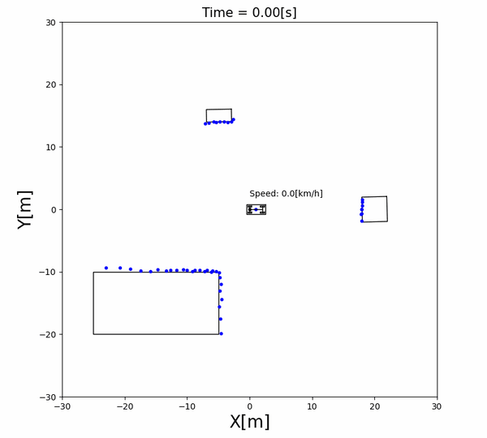
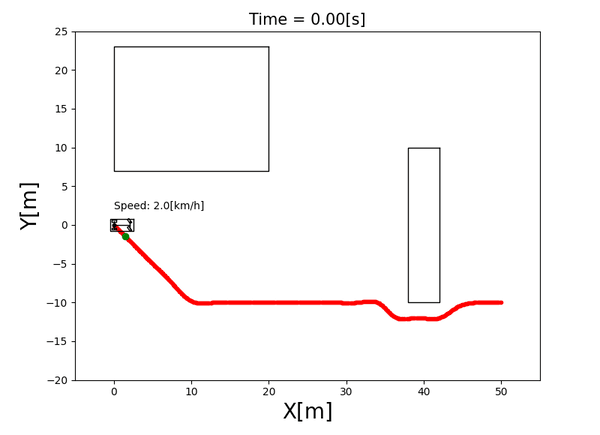
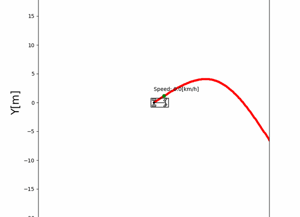
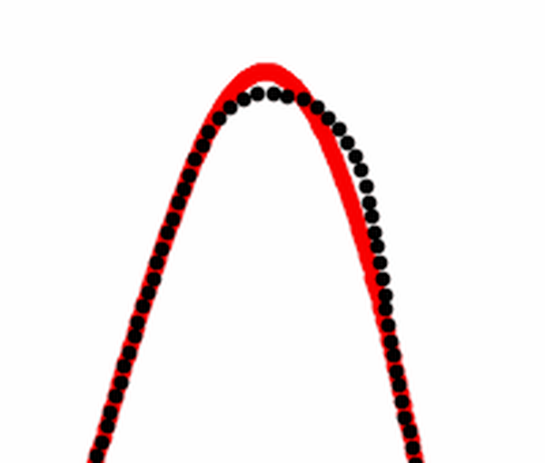
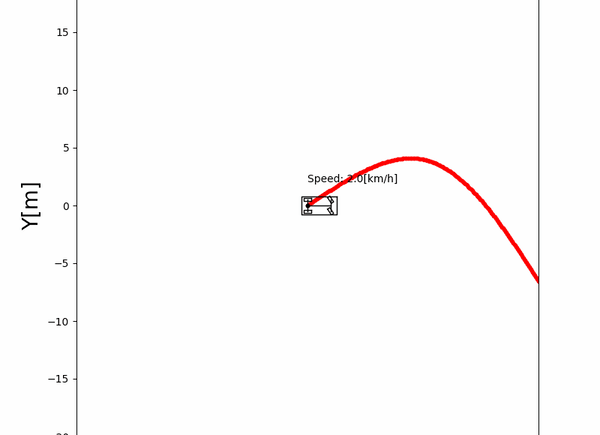
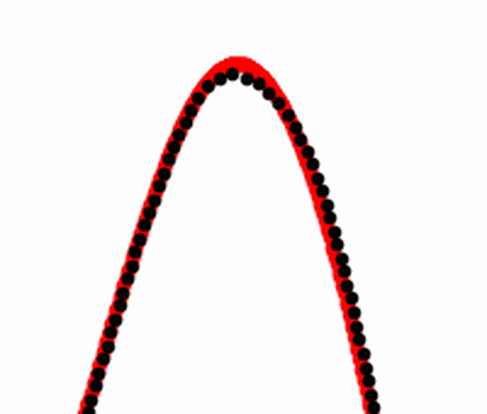
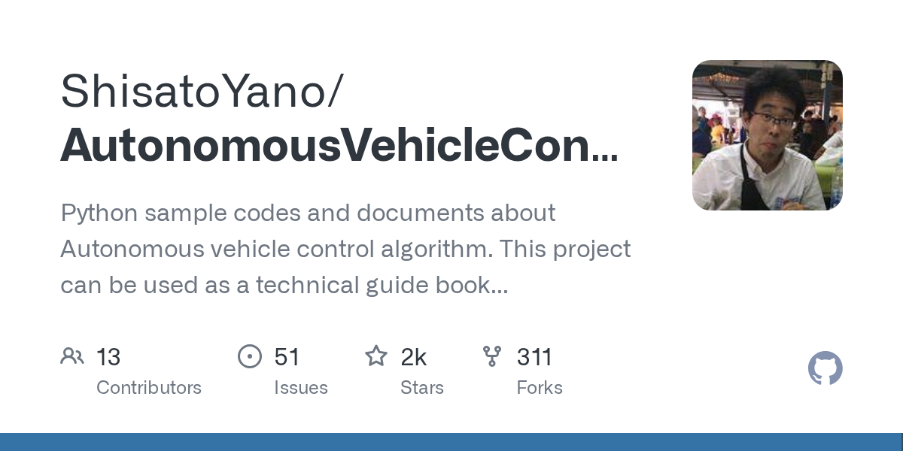

<div class="relative px-14 pt-12">

  <div class="mt-14">
    <h1 class="!text-4xl !font-black !leading-tight text-[var(--yano-accent)]">自動運転のアルゴリズムは、<br>Pythonだけで動かしながら学べる</h1>
    <div class="mt-4 text-xl font-bold text-gray-500">Learn autonomous driving algorithms by running them, with just Python</div>
    <div class="mt-4 text-lg font-bold text-gray-400">//localboast Tokyo 2026.11.05</div>
  </div>

  <div class="absolute left-14 top-[420px] flex items-center gap-5">
    
    <div>
      <div class="text-xl font-bold">Shisato Yano</div>
      <div class="text-sm text-gray-400">自動運転システムエンジニア / Autonomous driving software engineer</div>
    </div>
  </div>
</div>

---

## 自己紹介 <span class="en">About me</span>

<div class="mt-6 flex items-center gap-12">
  
  <div>
    <div class="text-4xl font-black">Shisato Yano</div>
    <div class="mt-4 text-base leading-relaxed text-gray-600 dark:text-gray-300">
      仕事: 車や船の自動運転システムを作るソフトウェアエンジニア<br>
      <span class="text-sm text-gray-400">Software engineer building autonomous driving systems for cars and ships</span><br>
      作ったもの: 自動運転の入門書OSS(GitHub ★1.9k)<br>
      <span class="text-sm text-gray-400">Built: an open-source beginner's guide to autonomous driving</span>
    </div>
    <div class="mt-4 flex gap-6 text-base">
      <a href="https://x.com/4310sy" target="_blank" class="flex items-center gap-2 !text-gray-700 dark:!text-gray-300 !border-none">
        <carbon-logo-x class="text-xl" />@4310sy
      </a>
      <a href="https://github.com/ShisatoYano" target="_blank" class="flex items-center gap-2 !text-gray-700 dark:!text-gray-300 !border-none">
        <carbon-logo-github class="text-xl" />ShisatoYano
      </a>
    </div>
  </div>
</div>

<Callout label="今日のゴール / Today's goal" class="mt-8">
  自動運転のアルゴリズムは、Pythonだけで動かしながら学べる
  <div class="text-sm text-gray-500 dark:text-gray-400">You can learn autonomous driving algorithms by running them, with just Python</div>
</Callout>

<!--
25秒。「難しそうな自動運転を、手元のPythonで動かして学べるようにしたOSSを見せます」
-->

---

## 自動運転は「見る → 決める → 動かす」の繰り返し <span class="en">Sense → Plan → Act, over and over</span>

<div class="mt-6 grid grid-cols-3 gap-6 text-center">

<div v-click>
  
  <div class="mt-2 text-xl font-black text-[var(--yano-accent)]">見る <span class="text-sm text-gray-400">Sense</span></div>
  <div class="text-sm">センサで周りの障害物を見つける</div>
</div>

<div v-click>
  
  <div class="mt-2 text-xl font-black text-[var(--yano-accent)]">決める <span class="text-sm text-gray-400">Plan</span></div>
  <div class="text-sm">ぶつからない道を決める</div>
</div>

<div v-click>
  
  <div class="mt-2 text-xl font-black text-[var(--yano-accent)]">動かす <span class="text-sm text-gray-400">Act</span></div>
  <div class="text-sm">決めた道どおりにハンドルを切る</div>
</div>

</div>

<KeyMessage v-click>

  今日は「動かす」= ハンドルの切り方の話 <span class="en">Today: how to steer</span>

</KeyMessage>

<Ref>

<carbon-logo-github /> [ShisatoYano/AutonomousVehicleControlBeginnersGuide](https://github.com/ShisatoYano/AutonomousVehicleControlBeginnersGuide)

</Ref>

<!--
40秒。人間の運転と同じ: 目で見て、どこを通るか決めて、ハンドルとアクセルを操作する。
専門用語では 認識・経路計画・制御。今日はこのうち「動かす」を扱う
-->

---

## なぜ作っているのか <span class="en">Why I build this</span>

<div class="mt-6 grid grid-cols-2 gap-10">

<div>
  <div class="text-lg font-black text-gray-500">自分が学び始めたとき <span class="text-sm text-gray-400">When I started learning</span></div>

- 入口が数式や論文しかなかった
- 車がどう動くのか想像できなかった
- 実車やセンサは、気軽には用意できない

</div>

<div v-click="2">
  <div class="text-lg font-black text-[var(--yano-accent)]">だから作った <span class="text-sm text-gray-400">So I built</span></div>

- Python と定番ライブラリだけで動く
- 40以上のシミュレーションを、コマンド1行で実行してアニメーションで見られる

</div>

</div>

<Callout v-click="3" label="目指すこと / What I aim for" class="mt-4">
  同じところでつまずく人を減らして、自動運転に関わる人を増やしたい
  <div class="text-sm text-gray-500 dark:text-gray-400">Fewer people stuck where I was, more people in autonomous driving</div>
</Callout>

<KeyMessage v-click="1">

  理想の入門書が世の中にない。だったら自分で作ればいい <span class="en">The guide I wanted didn't exist, so I'm writing it</span>

</KeyMessage>

<!--
40秒。自分が学び始めたときの苦労 → (クリック)理想の入門書がない、だったら自分で作ればいい → (クリック)作ったもの → (クリック)目指すこと。
必要なのは Python と NumPy・Matplotlib などの定番ライブラリだけ
-->

---

## ハンドルの切り方は、1行差し替えるだけで変えられる <span class="en">Swap one line to change how it steers</span>

<div class="mt-4 grid grid-cols-2 gap-6">

<Callout label="Pure Pursuit">
  少し先の道の一点を目指してハンドルを切る
  <div class="text-sm text-gray-500 dark:text-gray-400">Aim at a point a little ahead (like a human driver)</div>
</Callout>

<Callout label="Stanley">
  前輪がコースからずれた分を直す
  <div class="text-sm text-gray-500 dark:text-gray-400">Correct how far the front wheel is off the course</div>
</Callout>

</div>

<div class="mt-4">

````md magic-move
```python
# ハンドルの切り方(制御方式)を作る
controller = PurePursuitController(spec, course)
# 車に持たせて走らせる
vehicle = FourWheelsVehicle(state, spec, controller=controller)
vis.add_object(vehicle)
vis.draw()
```

```python
# ハンドルの切り方(制御方式)を作る
controller = StanleyController(spec, course)
# 車に持たせて走らせる
vehicle = FourWheelsVehicle(state, spec, controller=controller)
vis.add_object(vehicle)
vis.draw()
```
````

</div>

<KeyMessage v-click>

  車・コース・制御を部品に分けたので、制御だけ取り替えて比べられる <span class="en">Parts are separate, so you can swap and compare</span>

</KeyMessage>

<Ref>

シミュレーションのコードから抜粋(変数名は簡略化)

</Ref>

<!--
60秒。Pure Pursuitは人が運転するときと同じで、少し先を見る。Stanleyは足元(前輪)のずれを見る。
「なぜこの作りか」: 車・コース・制御方式を別々の部品にしてあるので、制御方式を取り替えても他は一切変えなくていい。
だから同じ条件で比べられる
-->

---

## 走らせて比べる <span class="en">Run and compare</span>

<div class="mt-2 text-center text-base">
  <span class="font-bold text-red-500">赤い線</span> = 走ってほしいコース、<span class="font-bold">黒い点</span> = 実際に走った跡
  <span class="text-sm text-gray-400">/ Red: the course, Black: where the car actually went</span>
</div>

<div class="mt-3 grid grid-cols-2 gap-8 text-center">

<div>
  <div class="text-lg font-black text-[var(--yano-accent)]">Pure Pursuit</div>
  <div class="grid">
    
    
  </div>
  <div v-click="1" class="mt-1 text-sm">急カーブで内側を近道し、抜けたあと外に膨らむ</div>
</div>

<div>
  <div class="text-lg font-black text-[var(--yano-accent)]">Stanley</div>
  <div class="grid">
    
    
  </div>
  <div v-click="1" class="mt-1 text-sm">急カーブでもコースにぴったり沿う</div>
</div>

</div>

<KeyMessage v-click="2">

  同じ車・同じコースでも、ハンドルの切り方で走りが変わる <span class="en">Same car, same course, different driving</span>

</KeyMessage>

<!--
80秒。まずGIFを流して全体を見せ、「右奥の急カーブに注目」と言ってからクリックで拡大図に切り替える。
Pure Pursuitは先の点を目指すので、急カーブでは内側に入り込む。Stanleyは前輪のずれを直し続けるのでコースから離れにくい
-->

---

## まとめ <span class="en">Summary</span>

<v-clicks>

<div class="summary">
  <div class="summary-verb">全体を</div>
  <div>見る・決める・動かす、の各段階をPythonのシミュレーションで</div>
</div>

<div class="summary">
  <div class="summary-verb">1行で</div>
  <div>コマンド1行で、アルゴリズムが動く様子をアニメーションで見られる</div>
</div>

<div class="summary">
  <div class="summary-verb">比べて</div>
  <div>部品を1行差し替えれば、同じ条件で方式どうしを比べられる</div>
</div>

</v-clicks>

<KeyMessage v-click>

  自動運転のアルゴリズムは、Pythonだけで動かしながら学べる <span class="en">Learn by running it, with just Python</span>

</KeyMessage>

<style>
.summary {
  display: grid;
  grid-template-columns: 7rem 1fr;
  gap: 1rem;
  align-items: center;
  margin-top: 1.5rem;
  font-size: 1.15rem;
}

.summary-verb {
  padding: 0.4rem 0;
  border-radius: 0.5rem;
  background: var(--yano-accent-soft);
  text-align: center;
  font-weight: 900;
  color: var(--yano-accent);
}
</style>

---

## 試してみてください <span class="en">Try it out</span>

<div class="mt-6 grid grid-cols-[3fr_2fr] gap-8 items-center">

<div>

```bash
git clone https://github.com/ShisatoYano/AutonomousVehicleControlBeginnersGuide
cd AutonomousVehicleControlBeginnersGuide
pip install -r requirements.txt
python src/simulations/path_tracking/stanley_path_tracking/stanley_path_tracking.py
```

<div class="mt-4 text-base leading-loose">

- 将来は書籍にする予定です / Planning to turn it into a book
- フィードバック・Issue・Star 大歓迎！ / Feedback welcome!

</div>

</div>

<div class="flex flex-col items-center gap-3">
  
  <a href="https://github.com/ShisatoYano/AutonomousVehicleControlBeginnersGuide" target="_blank" class="!border-none">
    
  </a>
</div>

</div>

<div class="mt-6 text-center text-xl font-black text-[var(--yano-accent)]">
  ご清聴ありがとうございました / Thank you! <span class="text-base text-gray-400">#localboast_tokyo</span>
</div>
