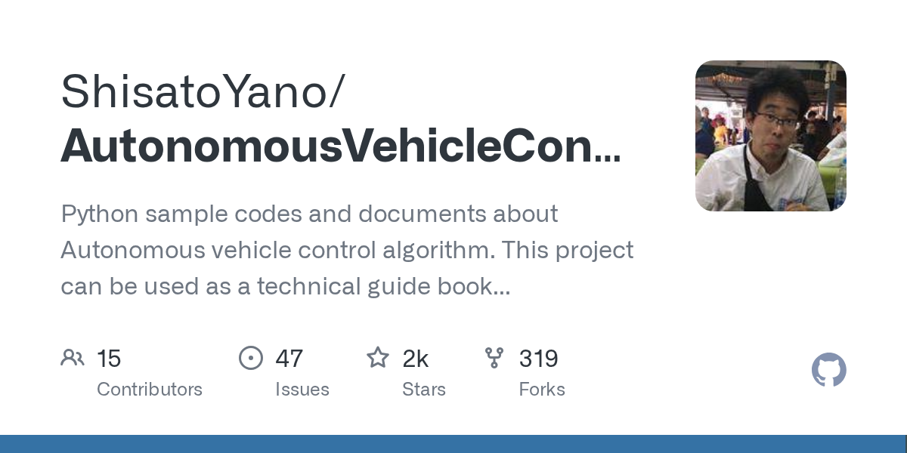
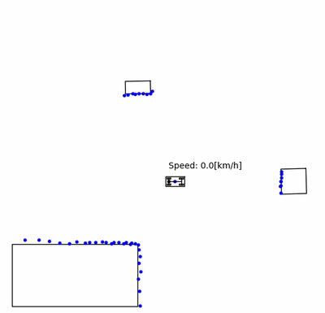
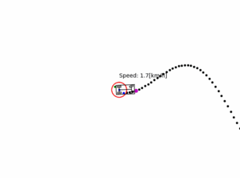
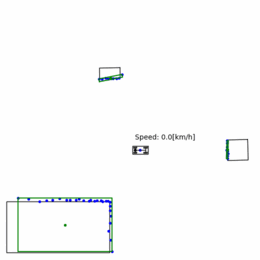
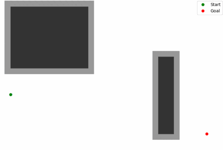
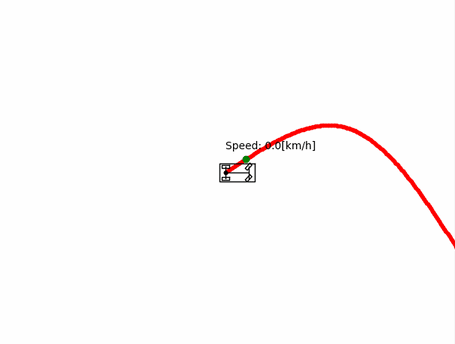
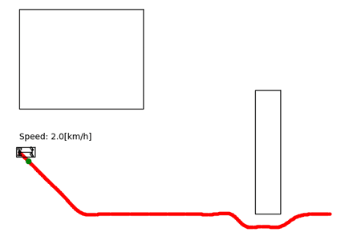

<div class="relative px-14 pt-12">

  <div class="mt-14">
    <h1 class="!text-4xl !font-black !leading-tight text-[var(--yano-accent)]">無ければ作ろう！<br>理想の技術書籍を作るOSSプロジェクト</h1>
    <div class="mt-4 text-xl font-bold text-gray-500">Want it or make it! An OSS project for the best tech readings</div>
    <div class="mt-4 text-lg font-bold text-gray-400">//localboast Tokyo 2026.11.05</div>
  </div>

  <div class="absolute left-14 top-[420px] flex items-center gap-5">
    
    <div>
      <div class="text-xl font-bold">Shisato Yano</div>
      <div class="text-sm text-gray-400">自動運転システムエンジニア</div>
    </div>
  </div>
</div>

---

## 自己紹介

<div class="mt-6 grid grid-cols-2 gap-10 items-center">

<div>
  <div class="flex items-center gap-5">
    
    <div>
      <div class="text-3xl font-black">Shisato Yano</div>
      <div class="mt-2 flex gap-5 text-base">
        <a href="https://x.com/4310sy" target="_blank" class="flex items-center gap-1 !text-gray-700 dark:!text-gray-300 !border-none">
          <carbon-logo-x />@4310sy
        </a>
        <a href="https://github.com/ShisatoYano" target="_blank" class="flex items-center gap-1 !text-gray-700 dark:!text-gray-300 !border-none">
          <carbon-logo-github />ShisatoYano
        </a>
      </div>
    </div>
  </div>
  <div class="mt-6 text-lg font-bold text-gray-600 dark:text-gray-300">
    自動運転システムを作るソフトウェアエンジニア
  </div>
</div>

<div>
  <div class="text-base font-bold text-gray-600 dark:text-gray-300">自動運転システムとは？</div>
  <div class="mt-2 grid">
    
    
  </div>
  <div class="grid mt-1 text-base">
    <div v-click="[1, 2]" class="[grid-area:1/1]">でっかいトラックを無人で動かしたり</div>
    <div v-click="2" class="[grid-area:1/1]">海の上で船を自律航行させたり</div>
  </div>
</div>

</div>

<Callout v-click="3" label="今日紹介するもの" class="mt-6">
  <div class="text-3xl font-black text-[var(--yano-accent)]">自動運転ソフトウェア開発の入門書を作るOSSプロジェクト</div>
</Callout>

<Ref v-click="[1, 2]">

[コマツ ニュースリリース(2026年4月22日)](https://www.komatsu.jp/ja/newsroom/2026/20260422)

</Ref>

<Ref v-click="2">

[エイトノット 公式サイト](https://8kt.jp/)

</Ref>

<!--
25秒。(クリック)鉱山の無人ダンプ → (クリック)小型船の自律航行と、陸でも海でも自動運転を作ってきた → (クリック)今日は、自動運転の入門書をOSSで作っている話をします
-->

---

## 自動運転を学ぶ上でのつらみ

<div class="text-base text-gray-600 dark:text-gray-300">
  <span class="text-3xl font-black text-[var(--yano-emphasis)]">技術の総合格闘技</span> と言われるくらい、必要な知識の幅が広い
</div>

<div class="autonomy">

<AutonomyScene class="mt-3" :play="$clicks >= 1" />

<div class="map mt-6">
  <div v-click="1" class="layer flow">
    <div class="row-label" style="grid-row: 1">要素技術</div>
    <div class="node" style="--i: 0; grid-column: 2 / 8">センシング</div>
    <div class="node" style="--i: 1; grid-column: 8 / 14">自己位置推定</div>
    <div class="node" style="--i: 2; grid-column: 14 / 20">認識</div>
    <div class="node" style="--i: 3; grid-column: 20 / 26">経路計画</div>
    <div class="node" style="--i: 4; --len: 2; grid-column: 26 / 32">制御</div>
  </div>
  <div v-click="2" class="layer base">
    <div class="row-label" style="grid-row: 2">基礎知識</div>
    <div class="node" style="--i: 0; grid-column: 2 / 7">数学</div>
    <div class="node" style="--i: 1; grid-column: 7 / 12">物理学</div>
    <div class="node" style="--i: 2; grid-column: 12 / 17">アルゴリズム</div>
    <div class="node" style="--i: 3; grid-column: 17 / 22">データ構造</div>
    <div class="node" style="--i: 4; grid-column: 22 / 27">ソフト設計</div>
    <div class="node" style="--i: 5; grid-column: 27 / 32">システム<br>アーキテクチャ</div>
  </div>
  <div v-click="3" class="layer">
    <div class="band" style="grid-area: 1 / 2 / 2 / 20"><span class="band-tag">よくある本のカバー範囲</span></div>
    <div class="band" style="grid-area: 2 / 2 / 3 / 22"></div>
    <div class="hole" style="grid-area: 1 / 20 / 2 / 32"></div>
    <div class="hole" style="grid-area: 2 / 22 / 3 / 32"></div>
  </div>
  <div v-click="4" class="gap-note">
    <span class="gap-label">全部を通しで学べる本は見つからなかった</span>
  </div>
</div>

</div>

<div v-click="5" class="finale">
  <div class="finale-text">無ければ作ろう！</div>
  <div v-click="6" class="finale-but">…でも、一人じゃ大変</div>
  <div v-click="7" class="finale-text oss">OSSにしてみんなで作ればいい！</div>
</div>

<style>
/* 場面の各段階と、流れの箱の点灯を同じ時刻で進める */
.autonomy {
  --scene-start: 0.9s;
  --scene-step: 1.2s;
}

/* v-click で見えた瞬間から、--i の順に少しずつずらして出す */
.flow:not(.slidev-vclick-hidden) .node {
  animation:
    pop 0.35s both calc(var(--i) * 0.12s),
    lit calc(var(--scene-step) * var(--len, 1)) calc(var(--scene-start) + var(--i) * var(--scene-step));
}

.base:not(.slidev-vclick-hidden) .node {
  animation: rise 0.4s both;
  animation-delay: calc(var(--i) * 0.12s);
}

.autonomy .layer {
  grid-template-rows: 3.5rem 3.5rem;
  row-gap: 1rem;
}

/* 本がカバーしていない箱を、赤い点線で囲んで抜けを目立たせる */
.hole {
  margin: -0.25rem;
  border: 3px dashed var(--yano-emphasis);
  border-radius: 0.6rem;
}

.gap-note {
  position: absolute;
  inset: auto 0 -2.5rem;
}

.gap-label {
  position: absolute;
  left: 50%;
  bottom: 0;
  transform: translateX(-50%);
  white-space: nowrap;
  font-size: 1.1rem;
  font-weight: 900;
  color: var(--yano-emphasis);
}

/* 締めの一言は KeyMessage(下部)ではなく、図の上に重ねて中央に大きく出す */
.finale-but {
  margin-top: 1.5rem;
  font-size: 1.75rem;
  font-weight: 700;
  color: var(--yano-muted);
}

.finale-text.oss {
  margin-top: 0.75rem;
}

.finale-text.oss:not(.slidev-vclick-hidden) {
  animation: pop 0.4s both;
}

@keyframes lit {
  15%, 85% { background: var(--yano-accent); color: white; }
}

@keyframes pop {
  from { opacity: 0; transform: scale(0.6); }
  to { opacity: 1; transform: scale(1); }
}

@keyframes rise {
  from { opacity: 0; transform: translateY(1rem); }
  to { opacity: 1; transform: translateY(0); }
}
</style>

<!--
60秒。自動運転は「技術の総合格闘技」と言われるくらい、知識の幅が広い。自分も新卒で配属されたとき、講習で学べたのは理論までで、残りは本・記事・サンプルコードの寄せ集めだった
→ (クリック)アニメーションが自動で流れる。センサで周りを見て、自分の位置を推定して、障害物を認識して、よける道を決めて、その道に沿うようにハンドルを切る。それぞれが1つの分野
→ (クリック)しかもその下に、数学、物理学、アルゴリズムとデータ構造、ソフト設計、それを1つにまとめるシステムアーキテクチャといった基礎知識がある
→ (クリック)本はたくさんある。でもよくあるのは、大体はカバーしているけれど、経路計画や制御までは無い、設計やアーキテクチャまでは触れていない、という本
→ (クリック)自分が探した範囲では、全部を通しで学べる本は見つからなかった
→ (クリック)だったら、無ければ作ろう！
→ (クリック)…でも、これを一人で全部書くのは大変
→ (クリック)だったら、OSSにしてみんなで作ればいい
-->

---

## OSS: AutonomousVehicleControlBeginnersGuide

<div class="mt-4 grid grid-cols-2 gap-8 items-center">

<div v-click="1">
  <div class="text-base font-black text-[var(--yano-accent)]">特徴</div>
  <ul class="feature-list">
    <li>自動運転入門書を作るOSSプロジェクト</li>
    <li>必要な基礎知識と要素技術を一通り網羅</li>
    <li>サンプルコードで設計と実装も学べる</li>
  </ul>
</div>

<div v-click="2">
  <div class="text-base font-black text-[var(--yano-accent)]">GitHubリポジトリ</div>
  <div class="repo">
    
    <div class="stats">
      <div><span class="stat-num">1,927</span><span class="stat-label">Stars</span></div>
      <div><span class="stat-num">14</span><span class="stat-label">Contributors</span></div>
      <div><span class="stat-num">314</span><span class="stat-label">Forks</span></div>
    </div>
  </div>
</div>

</div>

<div v-click="3" class="mt-5">
  <div class="text-base font-black text-[var(--yano-accent)]">いろんな自動運転シミュレーションができちゃう！！</div>
  <div class="sims">
    <figure><figcaption>センシング</figcaption></figure>
    <figure><figcaption>自己位置推定</figcaption></figure>
    <figure><figcaption>認識</figcaption></figure>
    <figure><figcaption>経路計画</figcaption></figure>
    <figure><figcaption>制御</figcaption></figure>
  </div>
</div>

<div v-click="4" class="finale">
  <div class="finale-text">世界中のエンジニアと協力すれば<br>理想の技術書が作れるはず！！</div>
</div>

<style>
.feature-list {
  font-size: 1.2rem;
  font-weight: 700;
  line-height: 1.4;
}

.feature-list li {
  margin-top: 0.5rem;
}

.repo {
  display: grid;
  grid-template-columns: 15rem 1fr;
  gap: 0.75rem;
  align-items: center;
  margin-top: 0.25rem;
}

.repo-card {
  border-radius: 0.375rem;
  box-shadow: 0 2px 8px rgb(0 0 0 / 0.15);
}

.stat-num {
  font-size: 1.6rem;
  font-weight: 900;
  line-height: 1.1;
  color: var(--yano-accent);
}

.stat-label {
  margin-left: 0.3rem;
  font-size: 0.85rem;
  font-weight: 700;
  color: var(--yano-muted);
}

.sims {
  display: grid;
  grid-template-columns: repeat(5, 1fr);
  gap: 0.5rem;
  margin-top: 0.25rem;
}

.sims img {
  width: 100%;
  height: 11.5rem;
  padding: 0.25rem;
  object-fit: contain;
  background: white;
  border: 1px solid color-mix(in srgb, var(--yano-muted) 40%, transparent);
  border-radius: 0.375rem;
}

.sims figcaption {
  text-align: center;
  font-size: 0.9rem;
  font-weight: 700;
  color: var(--yano-accent);
}
</style>

<!--
45秒。それで作っているのが、このAutonomousVehicleControlBeginnersGuide
→ (クリック)特徴は3つ。自動運転の入門書を作るOSSプロジェクトで、3枚目で抜けていた経路計画・制御やアーキテクチャまで含めて、基礎知識と要素技術を一通りカバーする。サンプルコードを動かしながら、設計と実装も学べる。正直に言うと、システムアーキテクチャと理論の解説ドキュメントはまだ書いている途中
→ (クリック)GitHubで公開していて、Starは約1,900、コントリビュータは14人、フォークは300以上。マージされたPRの8割以上は他の人から来ていて、自分の勉強にもなっている
→ (クリック)シミュレーションはこんな感じ。センシング、自己位置推定、認識、経路計画、制御と、要素技術ごとに全部Pythonで動く
→ (クリック)世界中のエンジニアと一緒に、全部入りの入門書を作る
-->

---

## OSSとしてのこだわり

<div class="mt-8 grid grid-cols-[21.5rem_minmax(0,1fr)] gap-5 items-start">

<div>
  <div v-click="1" class="point" :class="{ active: $clicks === 1 }"><span class="point-num">1</span>誰でもすぐ動かせる</div>
  <div v-click="2" class="point" :class="{ active: $clicks === 2 }"><span class="point-num">2</span>貢献しやすく、名前が残る</div>
  <div v-click="3" class="point" :class="{ active: $clicks >= 3 }"><span class="point-num">3</span>コードベースでカスタマイズ可能</div>
</div>

<div class="grid grid-cols-[minmax(0,1fr)]">

<div v-click="[1, 2]" class="detail">
  <div class="reason">
    <div class="detail-title">Dockerで環境構築を自動化</div>
    <div class="reason-body">コンテナを立ち上げるだけで、必要なライブラリが全部入る</div>
  </div>
  <div class="reason">
    <div class="detail-title">シミュレーションはコマンド一つで実行</div>
    <code class="reason-cmd">python src/simulations/…/pure_pursuit_path_tracking.py</code>
  </div>
  <div class="reason">
    <div class="detail-title">クロスプラットフォーム対応</div>
    <div class="chips">
      <span>✓ Linux</span><span>✓ Windows</span><span>✓ macOS</span>
    </div>
    <div class="reason-body mt-2">3つのOSで、変更のたびに自動テスト</div>
  </div>
</div>

<div v-click="[2, 3]" class="detail">
  <div class="detail-title">コントリビューションガイドを完備</div>
  <div class="guide">
    <div class="guide-file">HOWTOCONTRIBUTE.md</div>
    <ol class="guide-steps">
      <li>Issueで提案する</li>
      <li>ルールに沿って実装する(Python・シンプルに)</li>
      <li>ユニットテストを追加する</li>
      <li>PRを出してレビューを受ける</li>
    </ol>
    <div class="guide-more">ほかに: 不具合の報告と修正 / ドキュメントの追加 / AIコーディングツール向けのCLAUDE.md</div>
  </div>
  <div class="detail-note">マージされると、作者名付きでサンプル一覧に自動で載る</div>
</div>

<div v-click="3" class="detail">
  <div class="detail-title">モジュールの組み合わせで、多彩なシミュレーション</div>
  <div class="menu">
    <div><span class="menu-num">2</span>種<div class="menu-label">センサ</div></div>
    <div><span class="menu-num">3</span>種<div class="menu-label">自己位置推定</div></div>
    <div><span class="menu-num">16</span>種<div class="menu-label">経路計画</div></div>
    <div><span class="menu-num">6</span>種<div class="menu-label">制御</div></div>
  </div>
  <div class="grid grid-cols-2 gap-4 mt-3">
    <figure>
      
      <figcaption><b>位置を推定しながら走る</b><br>センサ + 自己位置推定 + 制御</figcaption>
    </figure>
    <figure>
      
      <figcaption><b>道を探してから走る</b><br>経路計画 + 制御</figcaption>
    </figure>
  </div>
  <div class="detail-title mt-4">コードも直接書き換えて、もっと自由に</div>
  <div class="reason-body whitespace-nowrap">実装がシンプルなので、アルゴリズムの中身まで手を入れやすい</div>
</div>

</div>

</div>

<style>
.point {
  display: flex;
  align-items: center;
  gap: 0.6rem;
  margin-bottom: 1.5rem;
  padding: 0.6rem;
  border-radius: 0.5rem;
  font-size: 1.15rem;
  white-space: nowrap;
  font-weight: 900;
  color: var(--yano-muted);
  transition: background 0.3s, color 0.3s;
}

.point.active {
  background: var(--yano-accent-soft);
  color: var(--yano-accent);
}

.point-num {
  display: grid;
  flex: none;
  place-items: center;
  width: 2.25rem;
  height: 2.25rem;
  border-radius: 9999px;
  background: var(--yano-muted);
  color: white;
}

.point.active .point-num {
  background: var(--yano-accent);
}

.detail {
  grid-area: 1 / 1;
  display: flex;
  flex-direction: column;
  justify-content: center;
  min-height: 20rem;
  padding: 1.25rem 1.5rem;
  border-radius: 0.5rem;
  background: var(--yano-accent-soft);
}

.detail-title {
  margin-bottom: 0.75rem;
  font-size: 1.15rem;
  font-weight: 900;
  color: var(--yano-accent);
}

.detail-note {
  margin-top: 1rem;
  text-align: center;
  font-size: 1rem;
  font-weight: 700;
}

.reason + .reason {
  margin-top: 1.25rem;
}

.reason .detail-title {
  margin-bottom: 0.3rem;
}

.reason-body {
  font-size: 0.95rem;
}

.reason-cmd {
  display: block;
  padding: 0.4rem 0.75rem;
  border-radius: 0.375rem;
  background: var(--yano-code-bg);
  color: var(--yano-term-fg);
  font-size: 0.8rem;
}

.chips {
  display: flex;
  flex-wrap: wrap;
  gap: 0.5rem;
}

.chips span {
  padding: 0.3rem 0.8rem;
  border: 2px solid var(--yano-accent);
  border-radius: 9999px;
  background: white;
  font-size: 1.05rem;
  font-weight: 700;
}

.guide {
  padding: 0.75rem 1rem;
  border: 1px solid color-mix(in srgb, var(--yano-muted) 40%, transparent);
  border-radius: 0.375rem;
  background: white;
}

.guide-file {
  padding-bottom: 0.4rem;
  border-bottom: 1px solid color-mix(in srgb, var(--yano-muted) 40%, transparent);
  font-family: var(--slidev-code-font-family, monospace);
  font-weight: 700;
}

.guide-steps {
  margin: 0.5rem 0 0;
  font-weight: 700;
  line-height: 1.6;
}

.guide-more {
  margin-top: 0.4rem;
  font-size: 0.8rem;
  color: var(--yano-muted);
}

.detail figure {
  text-align: center;
}

.detail img {
  width: 100%;
  border-radius: 0.375rem;
  background: white;
}

.menu {
  display: grid;
  grid-template-columns: repeat(4, 1fr);
  gap: 0.5rem;
  text-align: center;
  font-weight: 700;
}

.menu > div {
  padding: 0.3rem 0;
  border: 2px solid var(--yano-accent);
  border-radius: 0.5rem;
  background: white;
}

.menu-num {
  font-size: 1.6rem;
  font-weight: 900;
  line-height: 1.1;
  color: var(--yano-accent);
}

.menu-label {
  font-size: 0.85rem;
}

.detail img.combo {
  height: 5.5rem;
  object-fit: contain;
}

.detail figcaption {
  margin-top: 0.25rem;
  font-size: 0.8rem;
  line-height: 1.3;
}
</style>

<!--
50秒。OSSとして、こだわっていることが3つある
→ (クリック)1つ目、誰でもすぐ動かせること。Dockerで環境構築が自動でできて、シミュレーションはコマンド一つで動く。Linux・Windows・Macのどれでも動くように、変更のたびに3つのOSで自動テストしている
→ (クリック)2つ目、貢献しやすく、名前が残ること。コントリビューションガイドをちゃんと用意していて、Issueでの提案から、実装のルール、テストの追加、PRとレビューまでの手順が全部書いてある。AIコーディングツール向けのCLAUDE.mdもある。マージされると作者名付きでサンプル一覧に自動で載る
→ (クリック)3つ目、コードベースでカスタマイズできること。3枚目で出てきた要素技術がそれぞれモジュールになっていて、例えば経路計画は16種類、制御は6種類から選べる。これを組み合わせて走らせる。左はセンサで位置を推定しながら走る、右は道を探してからその道に沿って走る。組み合わせ次第でいろんなシミュレーションができる。さらに実装がシンプルなので、アルゴリズムの中身まで直接手を入れて自由に遊べる
-->

---

## まとめ

<v-clicks>

<div class="summary">
  <div class="summary-verb">仕組み</div>
  <div>見る・決める・動かす、の繰り返しで車が自分で走る</div>
</div>

<div class="summary">
  <div class="summary-verb">コード</div>
  <div>認識から制御まで、全分野が動くPythonコードになっている</div>
</div>

<div class="summary">
  <div class="summary-verb">遊び方</div>
  <div>部品を1行取り替えるだけで、走り方の違いを試せる</div>
</div>

</v-clicks>

<KeyMessage v-click>

  コードを動かして遊びながら、自動運転の面白さに触れてみよう

</KeyMessage>

<style>
.summary {
  display: grid;
  grid-template-columns: 7rem 1fr;
  gap: 1rem;
  align-items: center;
  margin-top: 1.5rem;
  font-size: 1.15rem;
}

.summary-verb {
  padding: 0.4rem 0;
  border-radius: 0.5rem;
  background: var(--yano-accent-soft);
  text-align: center;
  font-weight: 900;
  color: var(--yano-accent);
}
</style>

---

## 遊んでみてください

<div class="mt-6 grid grid-cols-[3fr_2fr] gap-8 items-center">

<div>

```bash
git clone https://github.com/ShisatoYano/AutonomousVehicleControlBeginnersGuide
cd AutonomousVehicleControlBeginnersGuide
pip install -r requirements.txt
python src/simulations/path_tracking/stanley_path_tracking/stanley_path_tracking.py
```

<div class="mt-4 text-base leading-loose">

- 将来は書籍にする予定です
- フィードバック・Issue・Star 大歓迎！

</div>

</div>

<div class="flex flex-col items-center gap-3">
  
  <a href="https://github.com/ShisatoYano/AutonomousVehicleControlBeginnersGuide" target="_blank" class="!border-none">
    
  </a>
</div>

</div>

<div class="mt-6 text-center text-xl font-black text-[var(--yano-accent)]">
  ご清聴ありがとうございました <span class="text-base text-gray-400">#localboast_tokyo</span>
</div>
